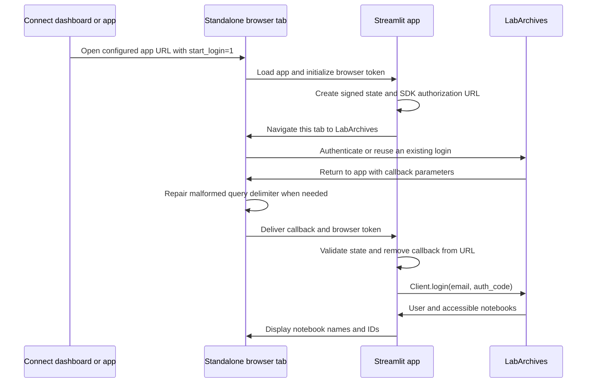

# LabArchives authentication with labapi, Streamlit, and Posit Connect

Working implementation and lessons from `labapi-deploy-test`, recorded on
November 19, 2026.

The user confirmed that the deployed app authenticated successfully after commit
`dee6ded` (`Repair malformed LabArchives callback query delimiters`). This guide
describes that implementation and the troubleshooting that produced it.

## 1. The working configuration

| Component | Version or setting used |
| --- | --- |
| Python | 3.12; the generated manifest records the local interpreter as 3.12.15 and requests `~=3.12.0`. |
| labapi | `1.2.0` |
| Streamlit | `1.67.0` |
| Local deployment tool | `rsconnect-python==1.32.0` |
| Connect app mode | `python-streamlit` |
| Entrypoint | `app.py` |
| Runtime dependencies | `requirements.txt` |
| Deployment method | Git-backed Posit Connect deployment using `manifest.json`. |

These are the versions validated for this repository. Keep the Python target
aligned with the runtime available on Connect. The deployment tool belongs in
the local development environment; the app requires only the packages declared
in `requirements.txt`.

The implementation is split across:

| File | Responsibility |
| --- | --- |
| [app.py](app.py) | App UI, configuration checks, login startup, callback processing, notebook display, and logout. |
| [labarchives_auth.py](labarchives_auth.py) | Browser components, browser identity, signed state, callback URL repair, and error classification. |
| [tests/test_app.py](tests/test_app.py) | Python and Streamlit AppTest regression tests. |
| [manifest.json](manifest.json) | Connect runtime metadata and bundled-file checksums. |
| [README.md](README.md) | Short setup and deployment instructions. |

## 2. Configuration and the different credentials

Configure the deployed content's environment variables on Connect, then restart
the app after changing them.

| Variable | Purpose |
| --- | --- |
| `ACCESS_KEYID` | The API access key ID issued by LabArchives. Required. |
| `ACCESS_PWD` | The corresponding LabArchives API access password. Required. |
| `API_URL` | The regional API base URL supplied by LabArchives. Defaults to `https://api.labarchives.com`. |
| `LABARCHIVES_CALLBACK_URL` | This Streamlit app's direct public URL. Required. |

The LabArchives key and API password identify the API client. The user's browser
login supplies the user-specific authorization code. A Posit Connect publisher
API key is used separately for deploying content.

Choose `API_URL` for the institution's actual LabArchives service, including the
appropriate regional or government service where applicable. Keep the API key,
API password, and API endpoint together as one configuration.

This app checks `os.environ` explicitly. Configure process environment variables;
placing values in a `.env` file alone does not satisfy those checks. The pinned
minimal `labapi` dependency needs no dotenv or built-in browser-auth extras for
this server callback flow.

Store actual credential values outside source control and the deployment bundle.
All URLs, keys, users, and codes in this guide are placeholders.

## 3. Set the callback URL to the app itself

Example production value:

```text
https://connect.example.org/content/YOUR_CONTENT_GUID/
```

Use the direct application URL, including its complete content path and trailing
slash. The app receives the callback through its normal Streamlit entrypoint;
there is no separate `/callback` route in this implementation.

The configured URL must have:

- HTTPS for the deployed app.
- The intended public hostname and content path.
- No query parameters, fragment, or embedded username/password.

For local development, the app permits HTTP on `localhost`, `127.0.0.1`, or
`::1`. For example:

```text
http://localhost:8501/
```

Browser storage is scoped by origin: scheme, hostname, and port. The app also
uses a hash of the complete configured callback URL to scope its browser token.
Keep `LABARCHIVES_CALLBACK_URL` stable across login startup and return.

## 4. Use labapi's server callback APIs

The two central calls are:

```python
auth_url = client.generate_auth_url(redirect_url)
user = client.login(email, auth_code)
```

`generate_auth_url()` builds the signed LabArchives authorization URL. The SDK
signs the full redirect URI, including the app's state query parameter. Construct
that redirect URI before calling the SDK. Use the generated authorization URL
as produced; editing its signed redirect URI can invalidate the signature.

LabArchives returns `email` and `auth_code` on success, or an `error` parameter on
failure. `Client.login()` exchanges the email and authorization code through the
LabArchives API and returns a `User` containing notebook access information.

`Client.default_authenticate()` provides a local interactive authentication flow
with a temporary callback server. A deployed Streamlit app needs the public
callback flow above so the browser returns to the hosted application.

The API request signing is handled by `labapi`. The app separately signs its own
browser-verification state; these are two distinct signatures with different
purposes.

## 5. The complete working browser flow



The login button opens:

```text
LABARCHIVES_CALLBACK_URL?start_login=1
```

That standalone tab initializes the browser token, constructs the signed login
request, and navigates to LabArchives. The user completes authentication there
and sees the notebook list in the returning tab.

The button can therefore be used from inside the Connect dashboard. The initial
dashboard view does not need to read browser storage or create an authorization
URL.

## 6. Why the iframe and cookie assumptions failed

The first implementation expected either `RSC-XSRF` or `_streamlit_xsrf` to be
available through `st.context.cookies`. Neither was available to the app in the
reported deployment, so login was disabled with a misleading message about
enabling cookies.

That observation did not establish that browser cookies were disabled or identify
which layer withheld them. The working implementation removes that dependency
and uses an app-created token in `localStorage`.

We also learned that the user was opening the app inside the Connect dashboard.
An iframe can have different storage availability or partitioning from a
standalone tab. Starting authentication in the iframe and returning outside it
can therefore produce different browser tokens.

The working flow starts and finishes authentication at the configured app URL
in a standalone tab. A browser regression test verified this with storage
explicitly blocked in the initial iframe and with a different starting hostname.

## 7. Browser identity and signed state

The browser component generates 32 cryptographically random bytes and stores
their 64-character hexadecimal representation in `localStorage`. Its storage key
contains a SHA-256 hash of `LABARCHIVES_CALLBACK_URL`.

The browser stores only that random token. API passwords, authorization codes,
email addresses, and notebook information are not placed in browser storage by
this implementation.

The app creates state with this structure:

```text
timestamp.random_nonce.hmac_signature
```

The HMAC-SHA256 signature covers a JSON representation of:

```text
[timestamp_and_nonce, configured_callback_url, browser_token]
```

The signing secret is the configured `ACCESS_PWD`. Validation checks the
signature using a constant-time comparison and requires an age between zero and
300 seconds. Future timestamps, expired states, and mismatched signatures fail.

This lets a new Streamlit session validate the returning browser without
depending on the original session's memory. All workers need the same callback
URL and secret, plus consistent clocks. Changing those settings during a login
attempt requires starting a fresh attempt.

State validation provides browser binding and a five-minute lifetime. This app
does not maintain a shared store of consumed nonces; it does not implement
single-use state tracking.

## 8. Streamlit component timing matters

The built-in Streamlit v2 component reads browser storage and sends its value to
Python. Its first render can return no token. The app waits for the component's
update and the ensuing rerun before processing the callback.

Preserve these ordering rules:

1. Mount the browser component and wait for a token.
2. Allow any raw callback URL repair to finish.
3. Read callback values with `st.query_params.get_all()`.
4. Remove callback parameters from the address bar.
5. Validate the callback and call `Client.login()` on success.

Clearing the callback before the asynchronous component or URL repair finishes
would discard the authorization code. Ordinary component reruns must also avoid
repeating the API exchange.

The JavaScript compares its token and error status with the values already
provided by Python before calling `setStateValue()`. This avoids unnecessary
updates and reruns. The components' JavaScript is static application code;
dynamic data is passed through the component's `data` argument.

## 9. The callback URL delimiter issue

This was the final compatibility fix before the user reported success.

The app adds a state query parameter to its redirect URI. A correctly combined
callback has this shape:

```text
https://connect.example.org/content/APP/?state=SIGNED_STATE&auth_code=CODE&email=user%40example.org
```

We reproduced the reported missing-code error with this shape:

```text
https://connect.example.org/content/APP/?state=SIGNED_STATE?auth_code=CODE&email=user%40example.org
```

The second `?` becomes part of the `state` value. The ordinary query parser sees
`state` and `email`, but no separate `auth_code`. That produced the exact reported
message:

```text
LabArchives login response is missing or repeats: auth_code
```

The browser component now repairs the specific second delimiter to `&` and
reloads the corrected URL once. Its pattern recognizes the app's signed-state
format followed by `auth_code`, `email`, or `error`. It leaves ordinary callbacks
unchanged. Python waits when it detects the malformed form so it cannot clear
the query before the browser completes that repair.

Repair the raw URL before decoding the parameter values. Extracting the code
from an already decoded state value and decoding it again can convert a valid
`+` to a space. Browser tests verified exact preservation of codes containing
`+`, `/`, `=`, and `%`.

The repaired callback still passes through the same signature, browser-binding,
expiry, and parameter-count checks. Empty codes and duplicate parameters remain
errors.

We intentionally did not collect the live callback URL. The malformed form was
a local reproduction of the observed symptom; the user confirmed live success
after deploying the repair. This does not establish that every LabArchives
deployment produces that format.

## 10. Report the actual category of failure

A failed LabArchives login can return only an `error` parameter. Requiring an
email, code, and state before checking for that error hid provider rejections
behind a generic expired-login message.

The working implementation handles the provider error before checking required
success parameters. It maps recognized error text to configuration guidance
without displaying the raw error or a potentially sensitive signed URL.

| Symptom | Interpretation and next step |
| --- | --- |
| Missing configuration variables | Set the named environment variables and restart the app. |
| Old message about enabling cookies | The earlier implementation could not see its expected framework cookies. Update to the browser-token flow. |
| `Browser storage is unavailable` | Storage really could not be read in the standalone login tab. Allow site data for the app's origin and reload. |
| API access key ID rejected | Check `ACCESS_KEYID` and `API_URL`; use the LabArchives client credentials. |
| Login signature rejected | Check `ACCESS_PWD` and the selected service/region. |
| Timestamp rejected | Start a new attempt; check server time if rejection is immediate and repeatable. |
| User cancelled or access denied | Start another attempt or resolve the provider-side access issue. |
| `auth_code (missing)` | The code was absent as a separate parameter. Check callback URL structure, including the second-`?` case. |
| `auth_code (empty)` | The parameter arrived with no value. This is distinct from the delimiter problem. |
| `auth_code (repeated)` | Multiple values arrived. Reject ambiguity rather than selecting one. |
| Browser verification failed or window expired | Start a fresh login. Check stable callback configuration, browser storage, shared worker settings, and elapsed time. |
| API exchange failed after validation | Check API connectivity, configuration, and code validity. |
| Login succeeds with no notebooks | The returned account has no accessible notebooks in the response. |

An immediate return to the app alone is insufficient to identify the cause. A
provider error and an existing authenticated LabArchives session are different
possibilities. Inspect parameter presence and the classified failure rather than
assuming the user needs to enter a password again.

## 11. Exchange the code and list every notebook

After callback validation and URL cleanup, the essential SDK operation is:

```python
from labapi import Client

with Client(timeout=30) as client:
    user = client.login(email, auth_code)
    account = {
        "email": user.email,
        "notebooks": [
            {"Notebook": notebook.name, "ID": notebook.id}
            for notebook in user.notebooks.all_values()
        ],
    }
```

Use `all_values()` for the pinned `labapi` version. The collection's regular
mapping views collapse duplicate notebook names, while `all_values()` preserves
each notebook. Displaying IDs makes same-named notebooks distinguishable.

Materialize the display data while the client context is open. The app then
closes the client and stores an account record containing the email and notebook
list in `st.session_state`. It does not retain a shared authenticated client or
globally cache one user's notebook data.

The list is a snapshot fetched at login. Logging out removes this app session's
account data; logging back in refreshes the list. A page reload requires a new
app login. App logout leaves the user's LabArchives and institutional SSO
sessions under those services' control.

## 12. Build and maintain the Connect manifest

From a Python 3.12 environment at the repository root:

```sh
python -m pip install -r requirements.txt
python -m pip install rsconnect-python==1.32.0

rsconnect write-manifest streamlit . \
  --entrypoint app.py \
  --overwrite \
  --exclude '.*' \
  --exclude '.*/**' \
  --exclude '__pycache__/**' \
  --exclude 'tests/**'
```

Important details from this repository:

- `.python-version` selects 3.12. The CLI reads it when generating the runtime
  requirement, even though hidden files are excluded from the bundle.
- Keep the explicit, pinned `requirements.txt`. `--force-generate` would replace
  it with packages from the local environment, potentially including deployment
  tools and unrelated development dependencies.
- Both hidden-file and hidden-directory exclusions matter. Excluding `.*` alone
  did not remove nested `.mypy_cache` contents from a generated manifest.
- Include both application Python files. The browser component code is inline
  in `labarchives_auth.py`, so it needs no separately built JavaScript package.
- Verify the manifest's file list and checksums. Documentation files included in
  the bundle also need updated checksums after editing them.
- Push the new manifest together with its matching source and requirements,
  then redeploy that revision on Connect.

Connect also needs access to its configured package repository and the
LabArchives API endpoint. Environment restoration, app startup, browser login,
and the authenticated API exchange are separate things to verify.

## 13. Test the browser behavior as well as Python

The committed suite runs with:

```sh
python -m unittest discover -s tests -v
```

At the confirmed working revision, all 21 tests passed. They exercise callback
validation, configuration, notebook collections, session isolation, logout, and
error handling using mocked network-facing calls and actual installed `labapi`
user/notebook objects.

The troubleshooting also used a temporary Playwright harness with a real local
Streamlit server and Chromium. That harness is not part of the committed test
suite. LabArchives redirects and the login response were mocked. It verified:

- Login starts from the actual button inside a dashboard-style iframe.
- The initial iframe can have blocked storage and an alternate hostname.
- The configured standalone app URL is used before authentication begins.
- Missing forwarded cookies do not disable login.
- The component waits and reruns correctly, and redirects actually happen.
- Both normal and second-`?` callbacks reach the notebook list.
- Special characters in the code survive without extra decoding.
- Malformed provider-error callbacks are repaired and explained.
- A callback from a different browser context is rejected.
- Logout removes the notebook display.
- Unavailable storage produces the intended message.

Fully specify test environment variables, especially `API_URL`. An inherited
regional endpoint can cause a request to miss a mock registered for another
hostname. Block unmocked external requests in browser regression tests.

Python mocks alone did not catch the cookie, iframe, or URL-shape assumptions.
Browser tests validated those mechanics. The user's final live confirmation
provided the evidence that the complete deployed flow worked with their
LabArchives and Connect configuration.

## References

- [labapi on PyPI](https://pypi.org/project/labapi/)
- [LabArchives API: User Login / User ID Parameter](https://mynotebook.labarchives.com/share/LabArchives%20API/ODEuOXwyNy82My05My9UcmVlTm9kZS8yMjYyMTU0MTg3fDIwNy44OTk5OTk5OTk5OTk5OA==)
- [Posit Connect: Streamlit](https://docs.posit.co/connect/user/streamlit/)
- [Posit Connect: Git-backed content](https://docs.posit.co/connect/user/git-backed/)
- [rsconnect-python: write-manifest](https://docs.posit.co/rsconnect-python/commands/write-manifest/#write-manifest-streamlit)
- [Streamlit: query parameters](https://docs.streamlit.io/develop/api-reference/caching-and-state/st.query_params)
- [Streamlit: v2 components](https://docs.streamlit.io/develop/api-reference/custom-components/st.components.v2.component)
